  

  
  
  
  

## About me

Hi there! 👋 I'm a software developer who has been writing code professionally for over 5 years, mostly building mobile apps for iOS and Android in React Native and TypeScript. I enjoy the whole process: planning the architecture, writing the app and the Node.js backend behind it, setting up CI/CD and getting it through App Store and Google Play review. Above all, I care about apps that stay fast and reliable, even on low-end devices.

Outside of client work, I build my own apps and open-source tools. The biggest one is [Where Am I?](https://whereamigame.app), a multiplayer geography game I designed, built and published on my own. I also maintain AsoBeast, an App Store Optimization tracker, and a fully typed Google Play scraper for Node.js.

- 📱 **5+ years** of software development, focused on **mobile apps in React Native**
- 🚀 From architecture to App Store and Google Play releases, with CI/CD and automated tests
- ⚡ Performance tuning for low-end devices (cut one screen's render time from 10s to 1s)
- 🧩 Node.js and NestJS backends: REST, GraphQL and WebSockets
- 📦 Open-source author with 23k+ npm downloads a month
- 🌍 Based in Poland, working remotely

## Tech stack

**Mobile**

  
   
  
  
  
  

**Web and backend**

  

**Testing, release and cloud**

  
   
  
  
  
  

## Featured projects

| Project | What it is | |
| --- | --- | --- |
| **[google-play-scraper](https://github.com/MrAdex77/google-play-scraper)** | Fully typed Node.js library and CLI for Google Play data |   |
| **[AsoBeast](https://github.com/AsoBeast/asobeast)** | Open-source App Store Optimization (ASO) tool and keyword rank tracker (NestJS, Next.js, PostgreSQL, Redis) |  |
| **[Where Am I?](https://whereamigame.app)** | Multiplayer geography game for iOS and Android with real-time modes over WebSockets, maps, push notifications and in-app purchases |  |

## GitHub stats

  
  

  

